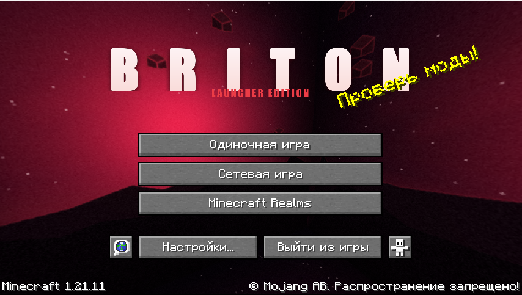

# BritonLauncher

Красивый лаунчер Minecraft для Windows на Python (pywebview + `minecraft-launcher-lib`).

> Не связан с Mojang или Microsoft. Minecraft — торговая марка Mojang AB.

## Возможности

- 👤 **Аккаунты сайта** — регистрация и вход на сайте проекта, вход в лаунчер по коду с сайта.
- 🛡️ **Роли и админ-панель** — главный админ `KostyaKosmos`, админ `BritonLauncher`; панель управления аккаунтами на сайте и раздел «Админка» в лаунчере.
- 🎮 **Офлайн-режим** — можно играть по нику без аккаунта.
- 🧩 **Fabric и Forge** — установка модлоадеров одной кнопкой под выбранную версию.
- 📦 **Modrinth внутри** — поиск и установка модов, ресурспаков и шейдеров.
- 🎚️ **Любая релизная версия** Minecraft и настройка оперативной памяти (`4G`, `2048M`).
- 🎨 **6 тем оформления** и брендовое меню Minecraft (ресурспак с фоном, логотипом и сплэшами).
- 🖥️ **Отдельное окно консоли** с логами игры.
- 🔄 **Проверка обновлений** лаунчера через GitHub Releases.

## Скриншоты

Сайт проекта (GitHub Pages) — папка [`docs/`](docs/). Там же мокап интерфейса.

## Установка (для пользователей)

1. Скачай `BritonLauncher.exe` со страницы [Releases](../../releases/latest).
2. Запусти файл.
3. Введи ник и жми «Играть». Для аккаунта сайта: сайт → «Аккаунт» → «Получить код для лаунчера», затем в лаунчере «Войти по коду».

Ничего дополнительно ставить не нужно — все зависимости внутри `.exe`.

## Запуск из исходников

```powershell
pip install -r requirements.txt
python main.py
```

Требуется Python 3.10+ (проверено на 3.15) и Windows 10/11 x64.

## Сборка `.exe`

```powershell
build_exe.bat
```

Скрипт создаёт venv, ставит зависимости и собирает `dist\BritonLauncher.exe` через PyInstaller.
Либо вручную:

```powershell
pip install pyinstaller
pyinstaller --noconfirm --onefile --windowed ^
  --name BritonLauncher ^
  --collect-all webview ^
  --collect-all minecraft_launcher_lib ^
  --add-data "assets\BritonMenu.zip;assets" ^
  main.py
```

## Меню Minecraft (ресурспак)

В лаунчер встроен ресурспак `assets/BritonMenu.zip`: тёмно-красная панорама, логотип
`BRITON`, подпись `LAUNCHER EDITION` и свои сплэши. Он работает как обычный ресурспак
и не требует модов.



- В лаунчере: **Настройки → Меню Minecraft (ресурспак)** → «Установить / обновить».
- Пак копируется в `%LOCALAPPDATA%\.britonlauncher\resourcepacks\BritonMenu.zip`.
- Лаунчер включает его в `options.txt` (`resourcePacks`) и убирает из
  `incompatibleResourcePacks`, поэтому Minecraft не считает его несовместимым.
- Подходит для 1.20.1 и новых версий (в `pack.mcmeta` указан диапазон форматов).
- Если игра уже запущена, перезапусти её, чтобы увидеть новое меню.

Пересобрать пак из исходников:

```powershell
pip install pillow numpy
python tools/build_menu_pack.py
```

## Аккаунты и вход через сайт

Аккаунты хранятся в Supabase (Postgres) и общие для сайта и лаунчера: роли, баны и муты
действуют везде. Пароли хешируются на сервере bcrypt (`pgcrypto`), браузер получает только
токен сессии, а в базе лежит SHA-256 от этого токена.

1. Открой сайт → «Аккаунт» → зарегистрируйся или войди.
2. Нажми **«Получить код для лаунчера»** и скопируй код.
3. В лаунчере нажми **«Войти по коду»**, вставь код и войди.

Код формата `BLS2.<...>` одноразовый и действует 7 дней; в базе хранится только его хеш.
При запуске игры лаунчер проверяет статус аккаунта: забаненный игрок игру не запустит.

Старые аккаунты из `localStorage` переносятся автоматически при первом успешном входе,
если пароль совпал с локальным хешем.

## Админ-панель сайта

Открывается в разделе «Аккаунт» для администраторов:

- **Поиск** по нику и таблица аккаунтов: роль, статус, дата создания и последнего входа.
- **Баны** — забаненный аккаунт не может войти на сайт, получить код и запустить игру.
- **Муты** — аккаунт помечается как «МУТ» на сайте и в лаунчере.
- **Роли** — выдача и снятие администратора, удаление аккаунтов.
- **Журнал действий** — последние 60 операций (кто, кого, когда и причина).
- **Защита** — `KostyaKosmos` и `BritonLauncher` нельзя забанить, замутить, разжаловать
  или удалить; себя забанить тоже нельзя.

> Мут — это флаг аккаунта и пометка в интерфейсе. Он не блокирует чат внутри Minecraft:
> для этого нужен сервер с плагином. Бан блокирует вход, выдачу кода и запуск игры.

## Supabase

Проект: `https://lmjizrowtxuwlovbirge.supabase.co`. В `docs/script.js` и `main.py` вшит
публичный publishable-ключ — это нормально, он предназначен для клиента.

Схема лежит в `supabase/schema.sql` и применяется вручную:

1. Открой Supabase → **SQL Editor** → **New query**.
2. Вставь содержимое файла и нажми **Run**. Повторный запуск безопасен.

Что создаётся:

- таблицы `profiles`, `sessions`, `launcher_codes`, `action_log`, `setup_codes`;
- RPC `bl_register`, `bl_claim_fixed_admin`, `bl_login`, `bl_me`, `bl_logout`,
  `bl_create_launcher_code`, `bl_redeem_launcher_code`, `bl_account_status`,
  `bl_admin_data`, `bl_admin_action`;
- RLS и `REVOKE`: таблицы недоступны напрямую, только через `SECURITY DEFINER`-функции.

Одноразовые коды для фиксированных админов зашиты в `schema.sql` только хешами.
Пароль задаётся при регистрации через `bl_claim_fixed_admin` — сайт спросит код.

## Где хранятся данные

```
%LOCALAPPDATA%\.britonlauncher\
├── config.json        настройки + аккаунт сайта
├── nickname.txt       сохранённый ник
├── options.txt        настройки Minecraft (включая ресурспак меню)
├── servers.dat        список серверов
├── mods\
├── resourcepacks\     BritonMenu.zip — меню от лаунчера
├── shaderpacks\
└── custom_menu\index.html
```

Аккаунты сайта хранятся в Supabase. В браузере остаётся только токен сессии
(`localStorage: britonlauncher.token`), в `config.json` лаунчера — ник, роль и время входа.

## Структура проекта

```
main.py               лаунчер (GUI + логика + вход по коду с сайта)
assets/BritonMenu.zip брендовый ресурспак для меню Minecraft
tools/build_menu_pack.py  генератор ресурспака
supabase/schema.sql   схема базы: таблицы, RPC, RLS
requirements.txt      зависимости Python
build_exe.bat         сборка .exe
run.bat               быстрый запуск из исходников
docs/                 сайт для GitHub Pages
```

## Сайт (GitHub Pages)

Сайт лежит в `docs/` и публикуется через GitHub Actions (`.github/workflows/pages.yml`):
каждый пуш в `main` пересобирает страницу. Адрес:
`https://kostyaprocrom.github.io/BritonLauncher/`.

## Правовая информация

Лицензия на исходный код не предоставляется: все права сохранены за автором.

- Лаунчер не обходит и не отключает аутентификацию, проверку владения игрой или лицензионные проверки.
- Для игры в online-режиме нужен официальный аккаунт Minecraft.
- Пароли сайта не передаются в лаунчер: он получает только ник и роль после обмена одноразового кода.

### English summary

BritonLauncher is a free custom Minecraft launcher for Windows. Accounts live in Supabase
(shared by the website and launcher; bcrypt password hashes, session tokens stored as SHA-256).
The launcher accepts a one-time `BLS2` code from the website to learn the nickname, role and
status, then launches the game offline by nickname. It can also install official game versions,
Fabric/Forge loaders, and download mods/resource packs/shaders from Modrinth. It does not bypass
authentication, ownership or license checks.
